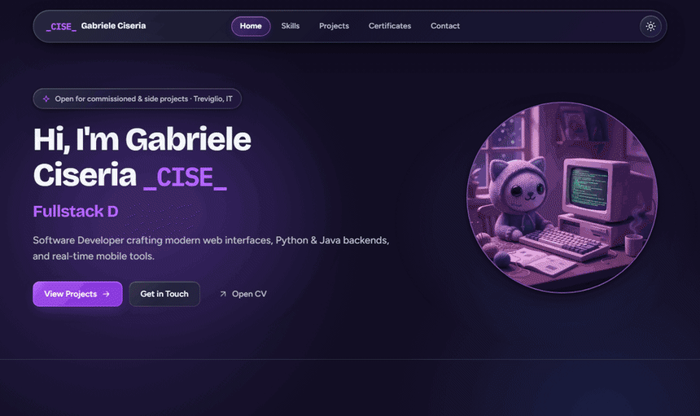

# 🚀 Gabriele Ciseria (`_CISE_`) — Developer Portfolio

Personal developer portfolio showcasing my open-source tools, mobile applications, IoT platforms, technical stack, and certifications.

---

## 🛠️ Architecture & Tech Stack

Built from scratch with **zero external UI/icon CDN frameworks** for instant loading, full accessibility, and fluid 60fps interactions:

- **Markup & SEO:** Semantic HTML5, Open Graph & Twitter Cards, JSON-LD (`WebSite` + `Person` structured data), `sitemap.xml`, and `robots.txt`.
- **Styling & Design System:** Custom CSS3 featuring a **Liquid Glass** surface system (`backdrop-filter` refraction + specular rims), native CSS Grid & asymmetric Bento layouts, CSS `light-dark()` & `color-scheme` tokens, and CSS Scroll-Driven Animations (`scroll()` / `view()`).
- **Client Logic:** Vanilla JavaScript (ES6+) powering data-driven rendering, sliding Liquid Glass selection pills, category filters, touch-scrub mobile navigation, 3D perspective tilt, pointer spotlight, and reload scroll restoration.
- **Typography & Icons:** *Bricolage Grotesque*, *Figtree*, and *IBM Plex Mono* paired with lightweight inline SVGs and compressed WebP assets.

---

## ✨ Key Features

- **🪟 Liquid Glass UI & FOUC-Free Theme Switching:** Adaptive Dark & Light themes synchronized with system `prefers-color-scheme` and `localStorage` via `<meta name="color-scheme">` before first paint.
- **🧭 Interactive Navigation & Touch Scrubbing:** Floating glass topbar with sliding selection/hover pills on desktop and a right-anchored compact mobile menu supporting continuous finger-drag selection.
- **🗂️ Filterable Project Showcase:** Category filtering (*All*, *AI & Python*, *Web & Mobile*, *IoT & Design*) with animated pill transitions and progressive *Show more / Show fewer* expansion while keeping all projects indexable in the DOM.
- **⚡ Performance & Accessibility:** Zero render-blocking JS/CSS libraries, explicit image dimensions to prevent CLS, keyboard-navigable controls, `:focus-visible` states, and full `prefers-reduced-motion` support.

---

## 📂 Featured Projects

- **[AI Burnrate Tool](https://github.com/Cise07/ai-burnrate-tool)** ([Live Demo](https://cise07.github.io/ai-burnrate-tool/)) — Real-time local token & API-equivalent cost tracker for Antigravity CLI, Claude Code, and Codex CLI with a React dashboard and CLI reporter.
- **[Android Sim Racing Dashboard](https://github.com/Cise07/android-racing-dashboard)** — Real-time GT3 telemetry dashboard in Kotlin & Jetpack Compose backed by a Python WebSocket bridge.
- **[bE-More — Smart Energy System](https://medium.com/@gizano/winning-a-tech-contest-with-be-more-integrating-iot-and-local-ai-for-a-greener-office-f906ec921963)** — Contest-winning fullstack IoT platform integrating Arduino sensors, React dashboards, and local AI analytics.
- **[BMO Local AI Assistant](https://github.com/Cise07/bmo-ai-assistant)** — Offline-first Python AI assistant inspired by BMO with optional web search.
- **[iOS System Status Widget](https://github.com/Cise07/ios-system-status-widget)** — JavaScript home-screen widget for iOS via Scriptable displaying live system metrics.
- **[Burrows-Wheeler Calculator](https://github.com/Cise07/burrows-wheeler-transform)** — Client-server Python application for lossless BWT string transformation.
- **[Curious Traveler](https://github.com/Cise07/curious-traveler)** — Python CLI tool generating structured trip itinerary cards from public REST APIs.
- **[E-Commerce SQL Simulation](https://github.com/Cise07/e-commerce-management-system)** — Web storefront simulation modeling relational schemas and SQL operations.
- **[The Bench of Kindness](https://primatreviglio.it/attualita/inaugurate-allarchimede-le-panchine-della-gentilezza/)** — AutoCAD-modeled civic installation at ISIS Archimede in Treviglio.

---

## 📫 Contact

- **Portfolio:** [cise07.github.io](https://cise07.github.io/)
- **Email:** [ciseriagabriele.business@gmail.com](mailto:ciseriagabriele.business@gmail.com)
- **GitHub:** [@Cise07](https://github.com/Cise07)
- **Instagram:** [@24.7_cise](https://www.instagram.com/24.7_cise)

---

*Designed & built by Gabriele Ciseria (`_CISE_`)*
